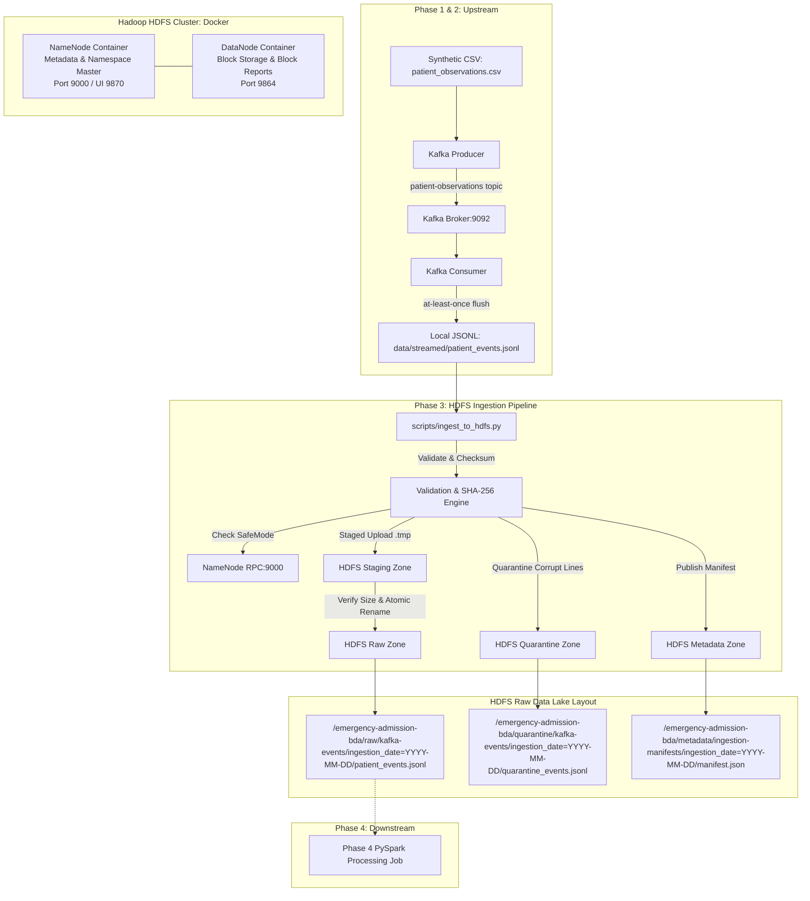

# Phase 3 — HDFS Ingestion & Raw Data Lake

**Project**: Emergency Admission Risk Prediction Using Big Data Analytics  
**Academic Subject**: Big Data Analytics (BDA)  
**Status**: **COMPLETED (Phase 3)**  
**Dataset Disclaimer**: All patient data and observation streams processed by this pipeline are purely **synthetic** generated for academic computer science demonstration. They do not originate from MIMIC-III, PhysioNet, or any clinical facility and have no clinical validity.

---

## 1. Why HDFS in Big Data Analytics?

Apache Hadoop Distributed File System (HDFS) serves as the persistent, distributed raw storage layer (Data Lake) for this project:

1. **Decoupling Stream Ingestion from Analytics Processing**:
   - Apache Kafka is an event-streaming engine optimized for transient, low-latency publish-subscribe queuing and temporary message retention.
   - HDFS is optimized for high-throughput batch reads over large datasets, sequential disk I/O, and long-term immutable persistence.
   - Decoupling these layers prevents downstream analytics (e.g., PySpark batch feature engineering) from overloading the Kafka broker.

2. **Distributed Scale & Fault Tolerance**:
   - In production enterprise settings, HDFS splits files into large blocks (e.g., 128 MB) and distributes them across commodity worker nodes with replication (typically 3x).
   - In our academic Docker deployment, HDFS demonstrates distributed filesystem semantics (RPC operations, block management, and POSIX-like distributed file commands) locally without requiring cloud infrastructure.

3. **High-Throughput Processing with Apache Spark**:
   - Apache Spark leverages data locality and distributed reads directly from HDFS blocks, enabling parallel worker tasks to process partitioned raw data lake files efficiently.

---

## 2. Architecture & Role of NameNode and DataNodes



### Roles within the Cluster
- **NameNode (Master Node)**:
  - Manages the directory tree namespace, filesystem metadata, permissions, and file-to-block mapping.
  - Controls safe mode (`dfsadmin -safemode`), coordinates atomic rename (`hdfs dfs -mv`) operations, and tracks block locations reported by DataNodes.
  - Does *not* store raw file contents directly; all block storage is delegated to DataNodes.
- **DataNode (Worker Node)**:
  - Stores the actual raw byte blocks on physical/virtual disk storage.
  - Serves read and write block requests from clients and sends periodic heartbeats and block reports to the NameNode.

---

## 3. Raw Data Lake Directory Structure

The HDFS directory tree adheres to modern Big Data Lake partitioning best practices:

```text
/emergency-admission-bda/
├── raw/
│   └── kafka-events/
│       └── ingestion_date=YYYY-MM-DD/
│           └── patient_events.jsonl
├── quarantine/
│   └── kafka-events/
│       └── ingestion_date=YYYY-MM-DD/
│           └── quarantine_events.jsonl
└── metadata/
    └── ingestion-manifests/
        └── ingestion_date=YYYY-MM-DD/
            └── manifest.json
```

- **`raw/kafka-events/`**: The immutable landing zone for all valid streaming event batches.
- **`quarantine/kafka-events/`**: Contains malformed records, corrupt JSON lines, or events missing mandatory clinical identifiers (`event_id`, `patient_id`), preserved with line numbers and error diagnostics.
- **`metadata/ingestion-manifests/`**: Contains machine-readable JSON execution receipts detailing byte sizes, SHA-256 checksums, record counts, timestamps, and validation statuses.

---

## 4. How Kafka JSONL Data Moves into HDFS

The data journey proceeds sequentially:
1. **Producer Serialization**: The Kafka producer reads rows from `data/raw/patient_observations.csv`, wraps them into a JSON payload with envelope metadata (`kafka_topic`, `schema_version`, etc.), and publishes to Kafka partitioned by `patient_id`.
2. **Consumer Archive**: The Kafka consumer polls batches, validates records, writes them to `data/streamed/patient_events.jsonl`, performs an OS `fsync`, and commits Kafka offsets (`enable_auto_commit=False`) only after local persistence.
3. **Container Volume Mount**: The Docker Compose `namenode` service mounts `./data` as `/shared-data:ro`.
4. **HDFS Ingestion**: The ingestion utility (`scripts/ingest_to_hdfs.py`) resolves `data/streamed/patient_events.jsonl` to `/shared-data/streamed/patient_events.jsonl`, stages the file in HDFS via `hdfs dfs -put`, verifies byte consistency, atomically renames it to the final partitioned target, and publishes an ingestion manifest.

---

## 5. Date Partitioning Strategy

- **`ingestion_date=YYYY-MM-DD`**: Partitions represent the **UTC arrival date** when the data lake ingested the batch, formatted according to ISO-8601.
- **Separation of Concerns**: Observation timestamps (`observation_timestamp`) represent clinical visit times and remain embedded within individual event payloads. Ingestion dates reflect batch pipeline arrival times.
- **Deterministic Testing**: The CLI accepts `--ingestion-date YYYY-MM-DD` or `$env:HDFS_INGESTION_DATE` so automated regression tests can target deterministic partition paths.

---

## 6. Safe Uploads, Atomic Commits, and Idempotency

To prevent race conditions, corrupted partial uploads, and accidental overwrites:

### 1. Staged Atomic Upload
1. The source file is first uploaded to a unique temporary staging file:  
   `/emergency-admission-bda/raw/kafka-events/ingestion_date=YYYY-MM-DD/.tmp_<uuid>_patient_events.jsonl`
2. The pipeline queries HDFS via `hdfs dfs -stat %b` to verify that the staged file size matches the local source file size exactly.
3. If sizes match, the file is atomically moved to its permanent target path via `hdfs dfs -mv`.
4. If an upload fails or size verification detects an anomaly, the temporary staging file is deleted immediately and a non-zero exit code is returned.

### 2. Idempotency & Conflict Prevention
- **Identical File (Idempotent No-Op)**: If the target file already exists in HDFS with the exact same byte size and SHA-256 hash, ingestion returns an idempotent `idempotent_noop` status without redundant network traffic.
- **Conflicting File Protection**: If the target file exists but differs in size, the pipeline immediately aborts with `FileExistsError` to protect historical data. Overwriting requires an explicit `--overwrite` / `$env:HDFS_OVERWRITE=true` parameter.

---

## 7. JSONL Validation & Quarantine Policy

Before uploading to HDFS, `scripts/ingest_to_hdfs.py` parses every line:
- Checks that each line is valid JSON.
- Verifies that the outer record contains a valid nested `"event"` dictionary.
- Checks that the event contains non-empty `event_id` and `patient_id` identifiers.
- Keeps valid records in the raw payload.
- If corrupt lines exist, writes a structured quarantine log (`quarantine_<date>.jsonl`) documenting the line number, error reason, and a 300-character snippet of the corrupt record, and uploads it to HDFS under `quarantine/kafka-events/ingestion_date=YYYY-MM-DD/`.

---

## 8. Ingestion Manifest Schema

Every successful or no-op ingestion generates a local manifest at `data/metadata/ingestion_manifests/ingestion_date=YYYY-MM-DD/manifest.json` and publishes it to HDFS under `metadata/ingestion-manifests/ingestion_date=YYYY-MM-DD/manifest.json`.

```json
{
  "manifest_version": "1.0",
  "project": "emergency-admission-risk-prediction",
  "data_origin": "synthetic",
  "source_filename": "patient_events.jsonl",
  "source_size_bytes": 74474,
  "source_sha256": "3775f0a17406a14782bb4bcbf0b666a7b7327ef3ca3bbbe47aee4b5a34a362bf",
  "record_count": 100,
  "valid_record_count": 100,
  "invalid_record_count": 0,
  "ingestion_date": "2026-10-13",
  "ingested_at_utc": "2026-10-13T19:28:30Z",
  "hdfs_destination": "/emergency-admission-bda/raw/kafka-events/ingestion_date=2026-10-13/patient_events.jsonl",
  "verification_status": "verified"
}
```

---

## 9. Windows PowerShell Workflow

### Step 1: Start Hadoop Infrastructure
```powershell
docker compose up -d namenode datanode
docker compose ps
```

### Step 2: Ensure Phase 2 Stream Archive Exists
```powershell
Test-Path .\data\streamed\patient_events.jsonl
Get-Content .\data\streamed\patient_events.jsonl -TotalCount 2
```

### Step 3: Run Ingestion
```powershell
powershell -ExecutionPolicy Bypass -File scripts\ingest_to_hdfs.ps1
```
*Optional overrides:*
```powershell
# Custom input file, explicit ingestion date, or forced overwrite:
powershell -ExecutionPolicy Bypass -File scripts\ingest_to_hdfs.ps1 -InputFile .\data\streamed\patient_events.jsonl -IngestionDate "2026-10-14" -Overwrite
```

### Step 4: Verify HDFS Storage & Health
```powershell
powershell -ExecutionPolicy Bypass -File scripts\verify_hdfs.ps1
```

### Step 5: Direct Container Inspection
```powershell
# List all files in the HDFS lake
docker compose exec namenode hdfs dfs -ls -R /emergency-admission-bda

# Check total disk usage
docker compose exec namenode hdfs dfs -du -h -s /emergency-admission-bda

# Inspect the published manifest
docker compose exec namenode hdfs dfs -cat /emergency-admission-bda/metadata/ingestion-manifests/ingestion_date=2026-10-13/manifest.json
```

### Step 6: Safe Shutdown
```powershell
docker compose stop namenode datanode
```
*(Do NOT use `docker compose down -v` unless you explicitly want to delete all HDFS data.)*

---

## 10. Linux / macOS Bash Workflow

### Step 1: Start Hadoop Infrastructure
```bash
docker compose up -d namenode datanode
docker compose ps
```

### Step 2: Run Ingestion
```bash
chmod +x scripts/ingest_to_hdfs.sh scripts/verify_hdfs.sh
./scripts/ingest_to_hdfs.sh ./data/streamed/patient_events.jsonl /emergency-admission-bda 2026-10-14
```

### Step 3: Verify HDFS Storage
```bash
./scripts/verify_hdfs.sh /emergency-admission-bda
```

### Step 4: Safe Shutdown
```bash
docker compose stop namenode datanode
```

---

## 11. Downstream Phase 4 PySpark Compatibility

Phase 4 Spark processing consumes the raw HDFS data directly. The ingestion pipeline satisfies all PySpark integration requirements:

- **HDFS Reader Path**:  
  `scripts/process_hdfs_with_spark.py` reads:  
  `hdfs://namenode:9000/emergency-admission-bda/raw/kafka-events`
- **Envelope Preservation**:  
  Spark expects an outer JSON dictionary containing an `"event"` dictionary with `event_id`, `patient_id`, `observation_timestamp`, vital signs, and target labels. Phase 3 preserves this envelope without alteration.
- **Partition Discovery**:  
  PySpark automatically discovers `ingestion_date` partition columns from the directory name (`ingestion_date=YYYY-MM-DD/`).
- **Idempotent Reads**:  
  Downstream Spark jobs deduplicate on `event.event_id`, ensuring complete end-to-end at-least-once streaming consistency.

---

## 12. Troubleshooting & Recovery

| Issue | Root Cause | Resolution |
|---|---|---|
| **NameNode in SafeMode** | NameNode startup is awaiting block reports from DataNodes. | Wait 30 seconds, or run: `docker compose exec namenode hdfs dfsadmin -safemode leave`. |
| **Connection Refused on Port 9000** | NameNode container is stopped or restarting. | Check `docker compose logs -f namenode` and ensure port 9000 is open. |
| **`Source file outside ./data` Error** | Input file is outside `./data/` and not mounted in NameNode container. | Place input files in `data/streamed/` to ensure `/shared-data` mapping in NameNode. |
| **FileExistsError on Re-ingestion** | A file with different size or content already exists in HDFS. | Specify `--overwrite` if intentionally replacing data. |
| **`DataNode: Connection refused` during upload** | DataNode is not healthy or NameNode cannot reach it. | Check `docker compose ps` and verify both `namenode` and `datanode` are on `bda-network`. |

---

## 13. Local Deployment Limitations

1. **Single-Node Storage**: In this local Docker development environment, `dfs.replication` is configured to `1` with a single DataNode to minimize local RAM usage. It demonstrates all HDFS distributed filesystem APIs, but does not provide physical disk fault tolerance.
2. **Mount-Based Ingestion**: The host machine interacts with HDFS through the Docker container's HDFS CLI and shared volume mount rather than a native host HDFS client binary.
3. **Synthetic Scale**: The dataset is sized for academic demonstration and testing (1,000 to 10,000 records). Production clusters would process gigabytes of streaming data across multi-node Hadoop clusters.
