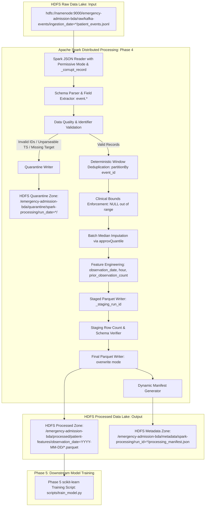

# Phase 4 — Apache Spark Data Processing & Feature Engineering

**Project**: Emergency Admission Risk Prediction Using Big Data Analytics  
**Academic Subject**: Big Data Analytics (BDA)  
**Status**: **COMPLETED (Phase 4)**  
**Dataset Disclaimer**: All patient data, vital signs, and risk outcomes processed by this pipeline are strictly **synthetic** generated for academic computer science demonstration. They do not originate from MIMIC-III, PhysioNet, or clinical facilities, and possess no clinical diagnostic validity.

---

## 1. Role of Apache Spark in the BDA Architecture

Apache Spark serves as the distributed computing engine for large-scale data transformation, data quality enforcement, and feature engineering:

1. **Distributed In-Memory Processing**: Unlike legacy MapReduce, Spark operates on Resilient Distributed Datasets (RDDs) and DataFrames in-memory, providing up to 100x performance gains for multi-pass iterative data transformations.
2. **Declarative Spark SQL & Catalyst Optimizer**: Spark optimizes relational transformations (projections, filters, window expressions, joins) via Catalyst, compiling logical plans into efficient JVM bytecode.
3. **Partitioned File I/O with HDFS**: Spark integrates seamlessly with Hadoop HDFS, distributing partitioned reads across cluster blocks and writing optimized columnar Parquet datasets.

---

## 2. Distributed Architecture & Pipeline Flow



---

## 3. Reading the HDFS Raw Archive & Parsing Nested JSON

### Input Format & Envelope
Phase 3 ingests raw Kafka streaming archives in JSON Lines format into HDFS under:
`hdfs://namenode:9000/emergency-admission-bda/raw/kafka-events/ingestion_date=YYYY-MM-DD/patient_events.jsonl`

Each JSONL record contains an outer Kafka envelope and an inner `event` payload:
```json
{
  "kafka_topic": "patient-observations",
  "kafka_partition": 1,
  "kafka_offset": 0,
  "kafka_key": "SYN000031",
  "consumed_at_utc": "2026-10-13T19:07:27Z",
  "event": {
    "event_id": "EVT000000007",
    "patient_id": "SYN000031",
    "observation_timestamp": "2025-03-01 10:58:00",
    "age": 53.0,
    "heart_rate": 105.0,
    "systolic_bp": 119.0,
    "diastolic_bp": 80.0,
    "spo2": 97.0,
    "respiratory_rate": 12.0,
    "temperature_c": 36.4,
    "previous_admissions": 1.0,
    "chronic_conditions_count": 5.0,
    "lactate": 1.2,
    "admission_within_24h": 0,
    "synthetic_data": true
  }
}
```

### Explicit Schema & Permissive Parsing
The Spark job uses an explicit `ENVELOPE_SCHEMA` including `_corrupt_record`:
- If a line contains invalid JSON syntax, Spark populates `_corrupt_record` with the original malformed string without crashing.
- Fields inside `event.*` are extracted and flattened alongside lineage metadata (`kafka_topic`, `kafka_partition`, `kafka_offset`).

---

## 4. Data Quality Validation & Quarantine Routing

Before modeling, every record is subjected to strict schema and integrity checks:

### Quarantine Rules
A record is routed to quarantine if:
1. `_corrupt_record` is not null (malformed JSON syntax).
2. `patient_id` is null or empty (`F.trim(patient_id) == ""`).
3. `event_id` is null or empty (`F.trim(event_id) == ""`).
4. `observation_timestamp` cannot be parsed into a valid timestamp.
5. `admission_within_24h` is null or not in `[0, 1]` (missing or non-binary target).

Quarantined records are written to:
`/emergency-admission-bda/quarantine/spark-processing/run_date=YYYY-MM-DD/run_id=UNIQUE_RUN_ID/`
with `error_category`, `error_reason`, `run_id`, and `processing_timestamp_utc`.

---

## 5. Deduplication Strategy

In distributed event streaming, Kafka delivers messages with **at-least-once** semantics, meaning network retries can introduce duplicates.

- **Deduplication Key**: Deduplication is performed strictly on `event_id`.
- **Tie-Breaker Rule**:
  ```python
  Window.partitionBy("event_id").orderBy(
      F.col("kafka_partition").asc_nulls_last(),
      F.col("kafka_offset").asc_nulls_last(),
      F.col("observation_ts").asc_nulls_last(),
  )
  ```
  The row with `_dup_rank == 1` is preserved deterministically.
- **Patient History Preservation**: Multiple distinct observations for the same patient (different `event_id`) are preserved intact. Deduplication is **never** applied on `patient_id` alone.

---

## 6. Numeric Bounds & Missing-Value Imputation

### 1. Data Quality Bounds (Distinguishing Missing vs. Invalid)
Values outside plausible physiological ranges are **converted to NULL** rather than discarding the entire clinical visit record:
- `age`: 0.0 to 120.0
- `heart_rate`: 25.0 to 240.0 bpm
- `systolic_bp`: 40.0 to 300.0 mmHg
- `diastolic_bp`: 20.0 to 200.0 mmHg
- `spo2`: 50.0 to 100.0 %
- `respiratory_rate`: 3.0 to 80.0 breaths/min
- `temperature_c`: 30.0 to 45.0 °C
- `previous_admissions`: 0.0 to 100.0
- `chronic_conditions_count`: 0.0 to 50.0
- `lactate`: 0.0 to 30.0 mmol/L

### 2. Batch Median Imputation
For missing or bounded numeric fields (`heart_rate`, `systolic_bp`, `diastolic_bp`, `spo2`, `respiratory_rate`, `temperature_c`, `lactate`):
- Medians are estimated across the deduplicated dataset using `approxQuantile(..., [0.5], 0.01)`.
- Nulls are coalesced with the batch median.
- All imputation operations and median values applied are recorded dynamically in the manifest.

*(Note: In Phase 5, scikit-learn fits an imputer strictly on the training fold to avoid data leakage; this batch imputation demonstrates distributed data preparation in Spark).*

---

## 7. Feature Engineering

The Spark job derives analytical features required for predictive modeling:

### 1. `observation_date`
Extracted from `observation_ts` (`F.to_date("observation_ts")`). Used as the partition key for Parquet storage.

### 2. `observation_hour`
Extracted from `observation_ts` (`F.hour("observation_ts")`, 0–23). Captures circadian variation in hospital emergency arrivals.

### 3. `prior_observation_count`
Represents the number of prior observations for the patient available in the dataset:
```python
patient_window = Window.partitionBy("patient_id").orderBy(
    F.col("observation_ts").asc(),
    F.col("event_id").asc()
)
F.row_number().over(patient_window) - F.lit(1)
```
- **Strict Exclusion**: Subtracting 1 guarantees the current observation is **excluded** from the count.
- **Causality**: Uses strictly preceding observations; does not use future information.

---

## 8. Output Storage: Why Columnar Parquet & Date Partitioning?

The processed feature table is written to HDFS in **Apache Parquet** format:
`/emergency-admission-bda/processed/patient-features/observation_date=YYYY-MM-DD/*.parquet`

### Why Parquet?
1. **Columnar Compression**: Parquet stores values column-by-column rather than row-by-row, achieving 70%+ disk compression via Snappy encoding.
2. **Column Pruning & Predicate Pushdown**: Downstream machine learning queries (e.g., Phase 5) only read the columns needed (`FEATURES`), skipping irrelevant fields without loading them from disk.
3. **Partition Pruning**: Querying a specific date range allows Spark to scan only relevant `observation_date=YYYY-MM-DD` directory subtrees.

---

## 9. Staged Atomic Publishing & Processing Manifest

To prevent corrupted datasets caused by interrupted jobs:
1. **Staged Write**: Data is first written to a temporary staging path:  
   `/emergency-admission-bda/processed/patient-features_staging_{run_id}`
2. **Verification**: Spark reads back the staged output to verify that row count and partitions match expectations.
3. **Publication**: The verified dataset is published to the final destination in `overwrite` mode.
4. **Dynamic Manifest**: A machine-readable JSON manifest is published to HDFS under `metadata/spark-processing/run_id={run_id}/processing_manifest.json` and mirrored locally to `data/metadata/spark_manifests/run_id={run_id}/processing_manifest.json`.

```json
{
  "manifest_version": "1.0",
  "project": "emergency-admission-risk-prediction",
  "data_origin": "synthetic",
  "run_id": "df0f4a29f2cd",
  "processing_timestamp_utc": "2026-10-13T19:41:40Z",
  "spark_version": "3.5.6",
  "input_path": "hdfs://namenode:9000/emergency-admission-bda/raw/kafka-events",
  "output_path": "hdfs://namenode:9000/emergency-admission-bda/processed/patient-features",
  "raw_record_count": 100,
  "valid_record_count": 100,
  "quarantined_record_count": 0,
  "duplicate_count": 50,
  "output_record_count": 50,
  "imputation_summary": {
    "heart_rate": { "pre_impute_null_count": 2, "median_applied": 82.0 },
    "systolic_bp": { "pre_impute_null_count": 2, "median_applied": 124.0 },
    "diastolic_bp": { "pre_impute_null_count": 0, "median_applied": 78.0 },
    "spo2": { "pre_impute_null_count": 1, "median_applied": 97.0 },
    "respiratory_rate": { "pre_impute_null_count": 0, "median_applied": 15.0 },
    "temperature_c": { "pre_impute_null_count": 1, "median_applied": 37.0 },
    "lactate": { "pre_impute_null_count": 0, "median_applied": 1.3 }
  },
  "output_format": "parquet",
  "partition_column": "observation_date",
  "status": "SUCCESS"
}
```

---

## 10. Phase 5 Downstream Compatibility

The output Parquet table strictly adheres to the input schema expected by `scripts/train_model.py`:

| Role | Field Name | Data Type | Notes |
|---|---|---|---|
| **Target** | `admission_within_24h` | Integer (0 or 1) | Binary emergency admission label within 24h |
| **Group** | `patient_id` | String | Used by `GroupShuffleSplit` to prevent patient identity leakage |
| **Feature** | `age` | Double | Age in years |
| **Feature** | `heart_rate` | Double | Heart rate in bpm |
| **Feature** | `systolic_bp` | Double | Systolic blood pressure |
| **Feature** | `diastolic_bp` | Double | Diastolic blood pressure |
| **Feature** | `spo2` | Double | Blood oxygen saturation |
| **Feature** | `respiratory_rate` | Double | Breaths per minute |
| **Feature** | `temperature_c` | Double | Body temperature in Celsius |
| **Feature** | `previous_admissions` | Double | Prior lifetime admissions count |
| **Feature** | `chronic_conditions_count` | Double | Comorbidities count |
| **Feature** | `lactate` | Double | Blood lactate measurement |
| **Feature** | `observation_hour` | Integer | Derived hour of arrival (0–23) |
| **Feature** | `prior_observation_count` | Integer | Derived historical observation count in dataset |
| **Partition** | `observation_date` | Date | Partition column (`YYYY-MM-DD`) |

---

## 11. Windows PowerShell Workflow

### Step 1: Ensure Hadoop NameNode & DataNode are Running
```powershell
docker compose up -d namenode datanode
docker compose ps
```

### Step 2: Run Phase 4 Spark Processing Job
```powershell
powershell -ExecutionPolicy Bypass -File scripts\process_hdfs_with_spark.ps1
```
*Advanced Options (with parameter overrides):*
```powershell
powershell -ExecutionPolicy Bypass -File scripts\process_hdfs_with_spark.ps1 -WriteMode overwrite -Master "local[*]"
```

### Step 3: Verify Output Parquet and Manifests
```powershell
powershell -ExecutionPolicy Bypass -File scripts\verify_spark.ps1
```

### Step 4: Inspect Local Parquet Export (Direct Python Inspection)
```powershell
py -3.13 -c "import pandas as pd; df = pd.read_parquet('data/processed/features.parquet'); print(df.info()); print(df.head(2))"
```

---

## 12. Linux / macOS Bash Workflow

```bash
# 1. Execute Spark job in Docker
chmod +x scripts/process_hdfs_with_spark.sh scripts/verify_spark.sh
./scripts/process_hdfs_with_spark.sh

# 2. Verify Parquet output and manifests
./scripts/verify_spark.sh
```

---

## 13. Troubleshooting & Common Failures

| Issue | Root Cause | Resolution |
|---|---|---|
| **`Permission denied: user=spark, access=WRITE`** | Spark container runs as user 1001, but HDFS directory belongs to `root`. | Fixed in configuration by setting `HADOOP_USER_NAME=root` and `hdfs dfs -chmod -R 777 /emergency-admission-bda`. |
| **`basedir must be absolute: ?/.ivy2/local`** | JVM cannot resolve user home for non-root user 1001. | Fixed in Dockerfile with `ENV HOME=/tmp` and `ENV SPARK_SUBMIT_OPTS="-Duser.home=/tmp -Divy.home=/tmp/.ivy2"`. |
| **`No records found in HDFS input path`** | Phase 3 ingestion was not run or raw directory is empty. | Run `powershell -File scripts\ingest_to_hdfs.ps1` to upload Phase 2 stream archive first. |
| **`NameNode in SafeMode`** | Cluster starting up and awaiting DataNode block reports. | Wait 30 seconds or run: `docker compose exec namenode hdfs dfsadmin -safemode leave`. |

---

## 14. Local Deployment Limitations

1. **Single-Node Execution**: In this academic demonstration setup, Spark runs in client mode with `master=local[*]`. In enterprise production clusters, Spark runs on YARN or Kubernetes across multiple distributed executor nodes.
2. **Dataset Scale**: Designed for 1,000–10,000 synthetic records for reproducible demonstration on a standard developer laptop without exhausting memory.
3. **Academic Exploration**: Batch median imputation is performed for demonstration; in production, feature imputers must be fitted strictly on training folds to prevent data leakage.
