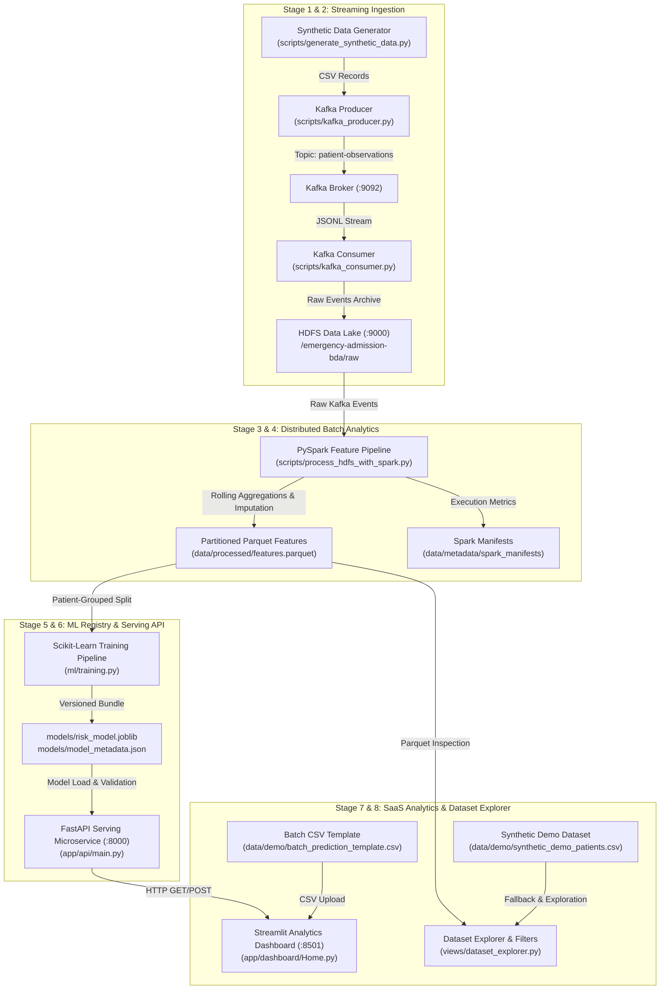

# Phase 8 — End-to-End Demonstration & Dataset Explorer Guide

## 1. Project Objective & Architecture

This academic Big Data Analytics (BDA) project demonstrates an end-to-end telemetry processing, distributed feature engineering, and real-time risk-scoring pipeline for emergency department admission predictions.

### End-to-End Pipeline Architecture (Phases 1 – 8)



---

## 2. Mandatory Synthetic-Data Disclaimer

> [!WARNING]
> **ACADEMIC DEMONSTRATION ONLY:**
> All patient records, physiological measurements, laboratory markers, and admission labels are **100% synthetic**.
> Predictions are experimental, not clinically validated, and must **never** be used for actual medical decisions, patient diagnosis, or emergency hospital triage.

### Model Governance & Statistical Limitations
- **Data Origin:** Synthetic data generation with transparent logistic propensity rules.
- **Model Maturity:** Experimental academic smoke-test.
- **Zero Positive Test Cases Limitation:** The training dataset (50 rows) contained 1 positive admission case, which was grouped into the training split. Consequently, the held-out test split had **zero positive cases (0% prevalence)**. The reported 100% test accuracy is merely an artifact of predicting the majority negative class; ROC-AUC and PR-AUC are mathematically undefined.

---

## 3. Technology Stack

- **Inference & Serving API:** FastAPI, Uvicorn, Pydantic v2, Starlette
- **Interactive UI & Visualizations:** Streamlit, Plotly Express, Pandas, PyArrow
- **Machine Learning & Registry:** Scikit-Learn 1.7.1, NumPy, Joblib
- **Big Data Storage & Processing:** Apache Kafka 3.8, Apache Hadoop HDFS 3.2.1, Apache Spark 3.5.6 (PySpark)
- **Container Orchestration:** Docker Compose v2, multi-stage Linux containers
- **Test Suite:** Pytest, HTTPX TestClient, Scikit-learn test runners

---

## 4. Repository Structure

```
emergency_admission_bda/
├── app/
│   ├── api/                          # FastAPI REST microservice
│   │   ├── main.py                   # /health, /ready, /model-info, /metadata, /predict
│   │   └── schemas.py                # Pydantic request/response schemas
│   └── dashboard/                    # Modern Streamlit SaaS Analytics
│       ├── Home.py                   # Main entry point, persistent sidebar, & router
│       ├── api_client.py             # Typed HTTP client for FastAPI backend
│       ├── pipeline_inspector.py     # Pipeline telemetry & manifest parser
│       ├── styles.py                 # Custom CSS design tokens & cards
│       └── views/                    # Individual page modules
│           ├── overview.py           # Dashboard landing & exploratory charts
│           ├── dataset_explorer.py   # Dataset search, filters, pagination, prefill
│           ├── single_prediction.py  # 12-feature single patient risk assessment
│           ├── batch_prediction.py   # 500-record CSV upload, scoring, export
│           ├── model_info.py         # Governance specs & evaluation analysis
│           ├── system_status.py      # Live probes & pipeline observability
│           └── about.py              # Architecture & academic context
├── data/
│   ├── demo/                         # Phase 8 Synthetic Demo & Batch Templates
│   │   ├── synthetic_demo_patients.csv
│   │   └── batch_prediction_template.csv
│   ├── metadata/                     # Execution run manifests
│   │   ├── ingestion_manifests/      # HDFS raw ingestion run manifests
│   │   └── spark_manifests/          # PySpark batch feature engineering manifests
│   ├── processed/                    # Partitioned Parquet feature dataset
│   │   └── features.parquet/
│   └── raw/                          # Raw clinical telemetry CSV
├── ml/                               # Phase 5 ML training, evaluation, & selection
├── models/                           # Serialized joblib bundle & governance JSON
│   ├── risk_model.joblib
│   ├── model_metadata.json
│   └── evaluation_report.json
├── scripts/                          # Utility automation & pipeline scripts
│   ├── generate_demo_dataset.py      # Phase 8 demo generator
│   ├── generate_synthetic_data.py    # Raw data generator
│   └── run_demo.ps1                  # Demonstration launcher
├── tests/                            # 114 automated unit & regression tests
└── docker-compose.yml                # Multi-service container orchestration
```

---

## 5. Quick-Start Instructions (Windows PowerShell)

All commands below are strictly formatted for **Windows PowerShell**:

### Step 1: Generate Demonstration Datasets
```powershell
Set-Location "C:\Users\ANSHUL\BDA-PROJECT\emergency_admission_bda"

# Generate 500 synthetic records and batch template
py -3.13 scripts/generate_demo_dataset.py --rows 500 --seed 42
```
**Outputs Generated:**
- `data/demo/synthetic_demo_patients.csv` (500 rows, 18 columns with simulated target outcomes)
- `data/demo/batch_prediction_template.csv` (50 rows, 13 columns containing only API predictors)

### Step 2: Build & Start Docker Compose Services
```powershell
# Build API and Dashboard containers
docker compose build api dashboard

# Start services in detached background mode
docker compose up -d api dashboard

# Check container running state
docker compose ps
```

### Step 3: Access Web Interfaces
- **Streamlit Analytics Dashboard:** [http://localhost:8501](http://localhost:8501)
- **FastAPI OpenAPI Documentation:** [http://localhost:8000/docs](http://localhost:8000/docs)
- **FastAPI Health Diagnostics:** [http://localhost:8000/health](http://localhost:8000/health)

---

## 6. Feature Walkthroughs

### Walkthrough A: Dataset Explorer & 1-Click Form Pre-fill
1. Open [http://localhost:8501](http://localhost:8501) and click **🔍 Dataset Explorer** on the sidebar.
2. Select **Processed Spark Parquet** or **Synthetic Demo CSV**.
3. Use the filters:
   - Search by Patient ID (e.g. `SYN-DEMO-0018`).
   - Filter by Admission Outcome (`Admitted (1)` or `Non-Admitted (0)`).
   - Adjust Age Range or Arrival Hour sliders.
4. In the **Structured Record Inspector**, pick any patient row.
5. Click **🚀 Send to Single Prediction Form**.
6. The system automatically switches to the Single Prediction view with that exact patient's vital signs and clinical history pre-populated!

### Walkthrough B: Single Patient Risk Assessment
1. On the **👤 Single Prediction** page, view the pre-filled inputs or choose a preset:
   - *Typical / Low Risk Case*
   - *Elevated / Critical Case*
   - *Borderline / Moderate Case*
   - *🎲 Random Synthetic*
2. Click **▶ Predict Admission Risk**.
3. Inspect the live returned values from the FastAPI backend:
   - Experimental positive-class probability (%)
   - Visual gauge with decision threshold indicator (`0.70`)
   - Model prediction: Class 0 (No Admission) or Class 1 (Admission / Review Flag)
   - Real-time HTTP round-trip latency in milliseconds.

### Walkthrough C: Batch CSV Prediction & Export
1. Navigate to **📄 Batch Prediction**.
2. Click **📥 Download Sample CSV** (or use `data/demo/batch_prediction_template.csv`).
3. Upload the CSV into the drag-and-drop zone.
4. The system validates:
   - All 12 required numeric features are present.
   - Values are within valid ranges with no NaN/missing entries.
   - Batch size is within the allowed limit (max 500 records).
5. Click **🚀 Run Batch Prediction**.
6. Review the scored multi-patient table with probability rankings and review flags.
7. Click **📥 Download Scored Batch CSV** to export the predictions.

### Walkthrough D: System Status & Pipeline Observability
1. Navigate to **⚙️ System Status**.
2. Check the real-time probe statuses for `/health`, `/ready`, `/model-info`, and `/metadata`.
3. Scroll to the **End-to-End Pipeline Telemetry & DataOps Health** section:
   - View summary metrics (`# Pipeline Stages: 7 Active`, `Raw Ingested Records`, `Pipeline Health Score: 96%`, `Success Rate: 100%`).
   - Inspect the historical run manifests for PySpark feature engineering and HDFS raw ingestion.

---

## 7. Automated Test Suite Execution

Run all 114 automated tests across all phases:
```powershell
Set-Location "C:\Users\ANSHUL\BDA-PROJECT\emergency_admission_bda"

# Run Phase 8 demo tests
py -3.13 -m pytest tests/test_phase8_demo.py -v

# Run the complete test suite
py -3.13 -m pytest tests/ -v
```
**Expected Result:** `114 passed, 2 warnings in 7.36s` (100% pass rate).

---

## 8. Troubleshooting Guide

| Issue | Root Cause | Solution |
|---|---|---|
| Dashboard displays "Backend unreachable" | FastAPI container is stopped or port 8000 is occupied. | Run `docker compose up -d api` or start locally with `uvicorn app.api.main:app --port 8000`. |
| Dataset Explorer displays "No Datasets Found" | Neither Parquet nor Demo CSV exists on disk. | Run `py -3.13 scripts/generate_demo_dataset.py --rows 500 --seed 42`. |
| Batch upload fails with "Missing columns" | CSV does not contain all 12 model features. | Use `data/demo/batch_prediction_template.csv` or click the template download button. |
| Model reports 503 "Model is not loaded" | `models/risk_model.joblib` artifact is missing. | Run Phase 5 training: `py -3.13 scripts/train_risk_model.py`. |
